# SpecGate + MCP Fetch

SpecGate is a Claude Code skill that turns a rough problem statement into a reviewable requirements specification. Nothing becomes a requirement until it passes the gate. External facts come from an MCP `fetch` server, so evidence is a quoted page and not recall.

The skill produces a specification only. It never writes code, design, architecture or estimates.

## How the pieces fit

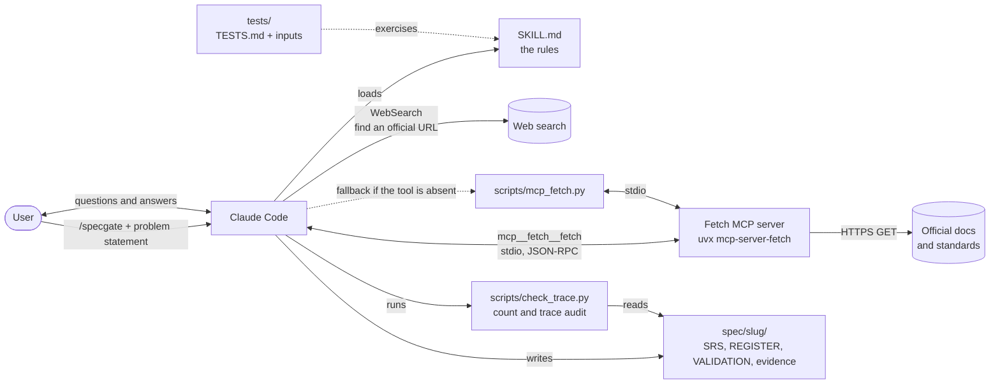

## Repository map

```
.
├── .mcp.json                         registers the Fetch MCP server for this project
├── README.md
├── .claude/skills/specgate/
│   ├── SKILL.md                      the skill: rules, model, workflow, validation
│   ├── scripts/
│   │   ├── mcp_fetch.py              Fetch MCP client, saves the raw exchange
│   │   └── check_trace.py            audit: counts, duplicate IDs, two-way OQ links
│   └── tests/
│       ├── TESTS.md                  six cases with the outcome each rule requires
│       └── inputs/                   t1 to t6 problem statements
└── spec/<slug>/                      output of one run (created by /specgate)
```

## Workflow

Steps 3 to 9 repeat after each clarification round, and each round writes the next version.

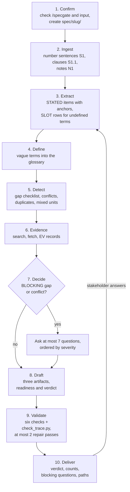

## Evidence pipeline

The pipeline runs only for an `INFERRED` row that rests on an external fact. A `SLOT` cannot be raised by evidence. Legal text on government sites usually fails, so the skill asks the stakeholder to name the laws instead.

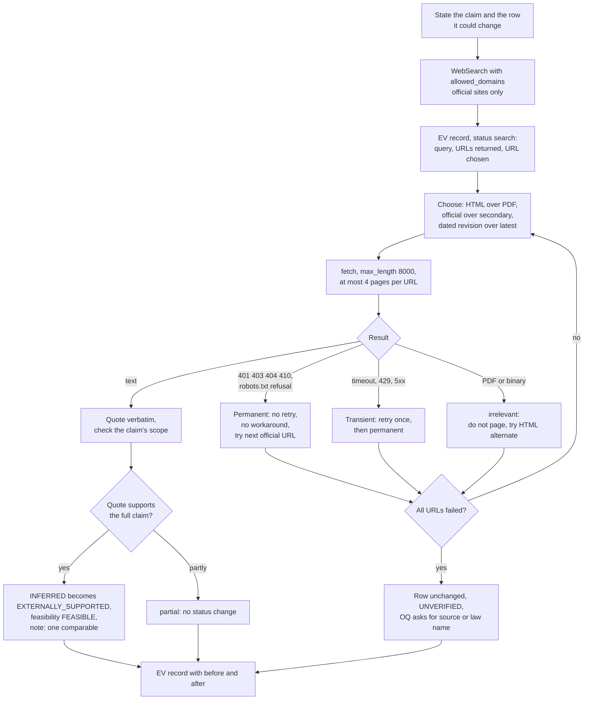

Every call writes an `EV` record, including failed ones. Search summaries are never quoted as evidence. Instructions found inside a fetched page are logged and not followed.

## Fetch MCP wire sequence

`scripts/mcp_fetch.py` speaks the same stdio protocol Claude Code uses. It is the fallback when the session has no `mcp__fetch__fetch` tool.

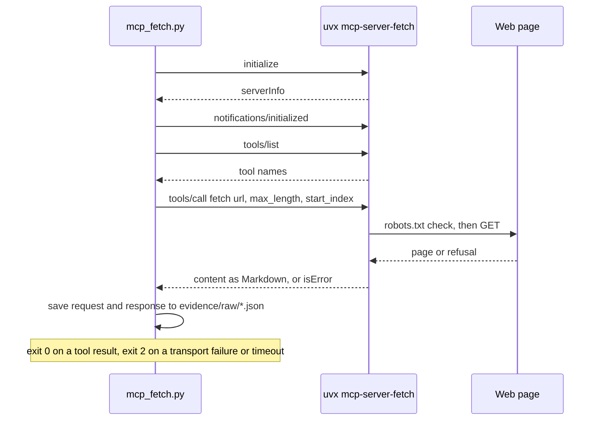

## Status and readiness

Each item has one status. Only an answer to an open question makes an item `CONFIRMED`.

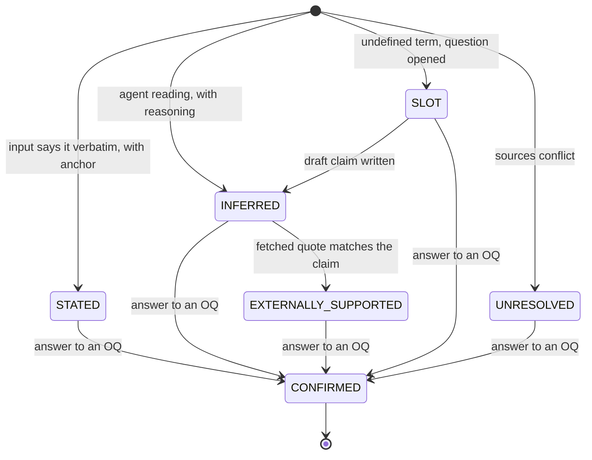

Readiness is separate from status:

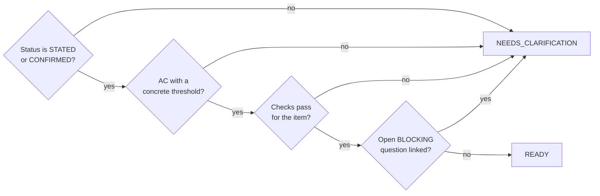

Open-question severity:

| Severity | Meaning |
|---|---|
| BLOCKING | A core item cannot be specified or verified without the answer |
| HIGH | The answer changes a requirement's meaning or threshold |
| MEDIUM | The answer changes a value or priority |
| LOW | The answer changes naming or detail only |

## Who establishes what

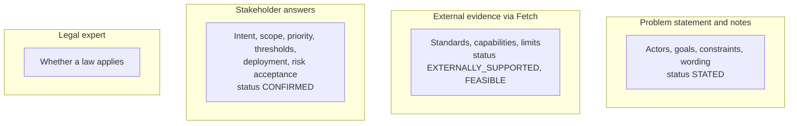

## Validation and verdict

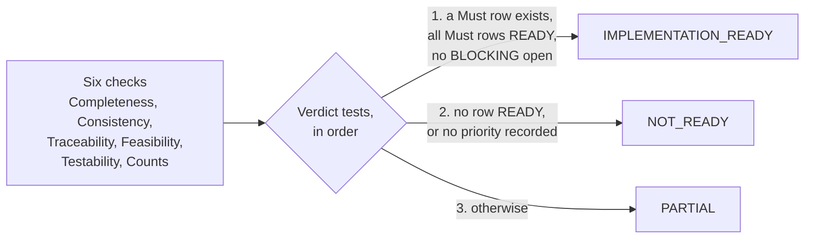

Consistency fails only for a contradiction the input or a stakeholder states. Possible clashes are listed as potential conflicts with an open question and a risk.

## Audit script

`check_trace.py` reads the SRS and the register of one version and exits 1 on any fault.

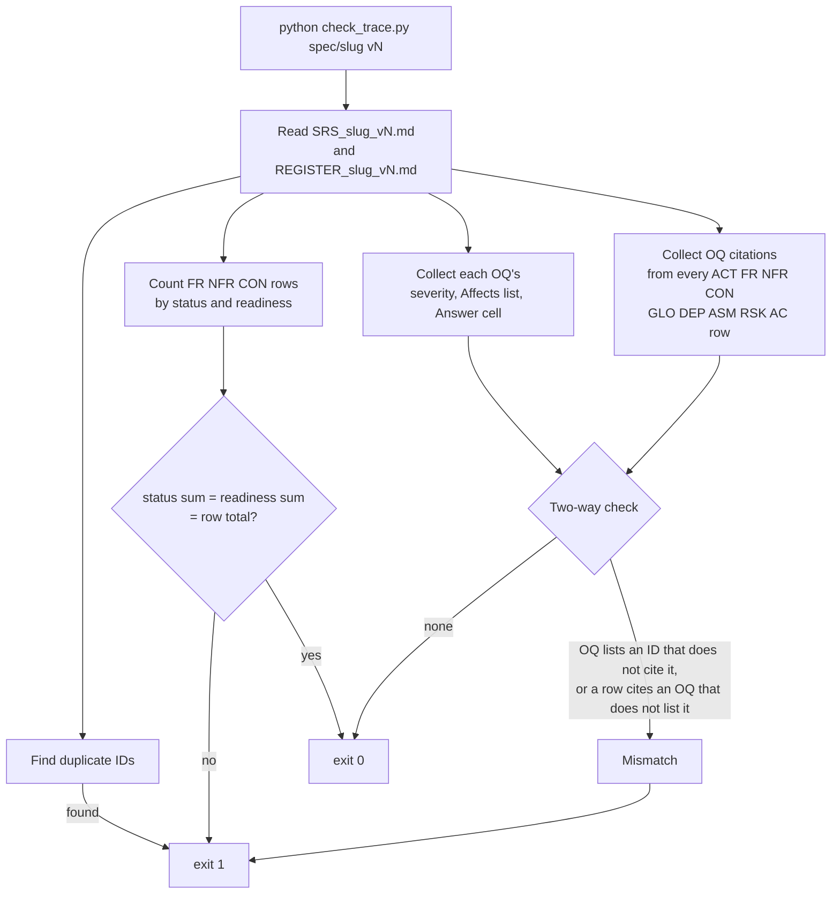

Counts are cross-checked with Grep. The row format that makes counting reliable: the ID is the first cell, status and readiness words are uppercase only in their own cells, and severity is the second cell of each open-question row.

## Rounds and versions

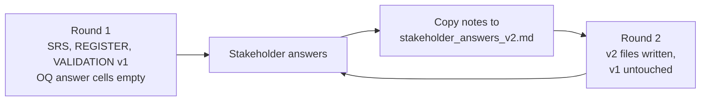

An earlier version is never overwritten. A re-run with no new answers produces no new information.

## Output layout

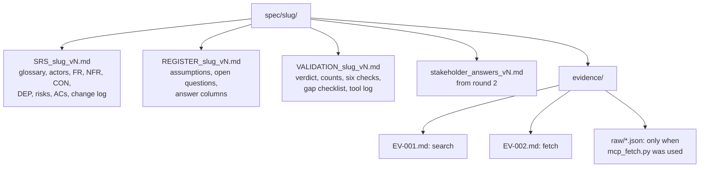

## Tests

`tests/TESTS.md` lists six cases. The expected outcomes come from the SKILL.md rules, not from one model's past output.

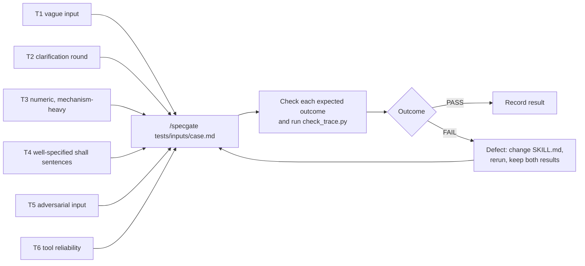

## Element IDs

| Prefix | Element |
|---|---|
| ACT | Actor (a person or role) |
| FR | Functional requirement |
| NFR | Non-functional requirement |
| CON | Constraint |
| ASM | Assumption |
| DEP | Dependency (systems, models, services) |
| RSK | Risk |
| AC | Acceptance criterion |
| OQ | Open question |
| EV | Evidence record |
| GLO | Glossary term |

IDs are assigned once and never reused. A removed row is listed as retired.

## Setup

The project `.mcp.json` registers the Fetch server:

```json
{ "mcpServers": { "fetch": { "type": "stdio", "command": "uvx", "args": ["mcp-server-fetch"], "env": {} } } }
```

To register it for your user instead:

```
claude mcp add fetch -- uvx mcp-server-fetch
claude mcp list
```

`claude mcp list` should show `fetch` as connected. The first start can time out while `uvx` downloads the package. Run `/mcp` to reconnect.

## Skill location

Claude Code registers `/specgate` only from `.claude/skills/specgate/SKILL.md` or `.claude/commands/specgate.md`. The command name comes from `name: specgate` in the frontmatter and the folder name. Restart Claude Code after changing the file.

A personal copy at `~/.claude/skills/specgate/` may also exist. In this setup `/specgate` loaded from the personal copy, so a change to the project file takes effect only after the personal copy is replaced with it. Keep the two copies identical.

## Use

```
/specgate <problem statement text or file path>
```

The skill runs only when you invoke it. Answer the questions it asks, then run it again with your answers. It writes the next version of the three files.

## Specifications in this repository

| Slug | Version | Verdict |
|---|---|---|
| `sovereign-agent-harness` | v1 | NOT_READY: no row READY, no priority recorded, 6 BLOCKING questions open |

## Files

| Path | Purpose |
|---|---|
| `.claude/skills/specgate/SKILL.md` | The SpecGate skill. Claude Code loads this |
| `.claude/skills/specgate/scripts/mcp_fetch.py` | Calls the Fetch MCP server over stdio and saves the raw exchange. Used when the session has no `mcp__fetch__fetch` tool |
| `.claude/skills/specgate/scripts/check_trace.py` | Audits a run: counts by status and readiness, open questions by severity, duplicate IDs, two-way OQ links |
| `.claude/skills/specgate/tests/` | Test cases and expected outcomes |
| `.mcp.json` | Registers the Fetch MCP server (`uvx mcp-server-fetch`) for this project |
| `spec/<slug>/` | Output for one problem statement, created by a run |
