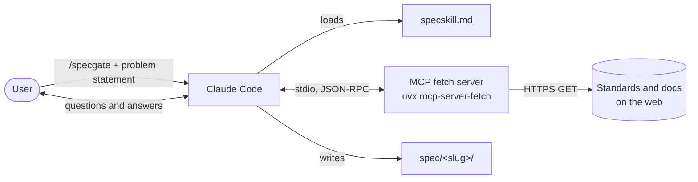
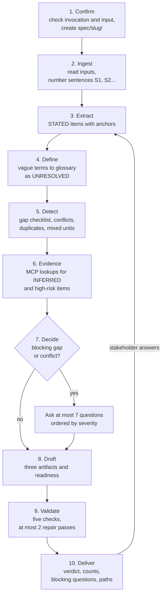
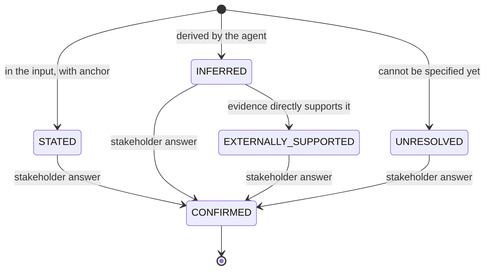
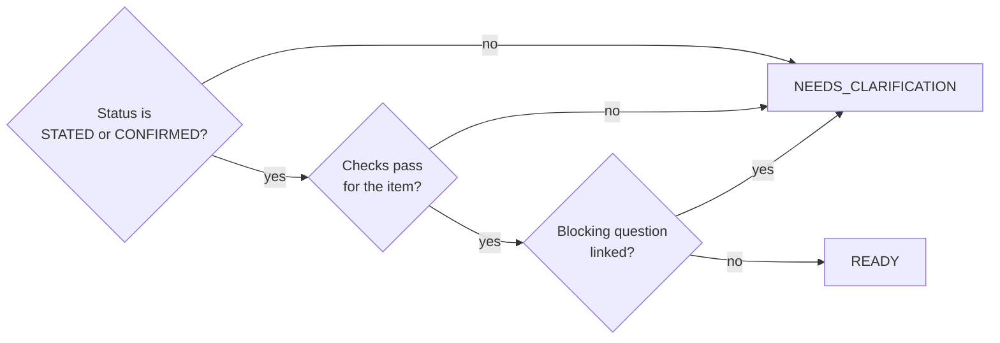
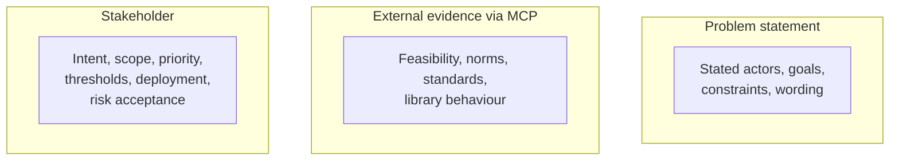
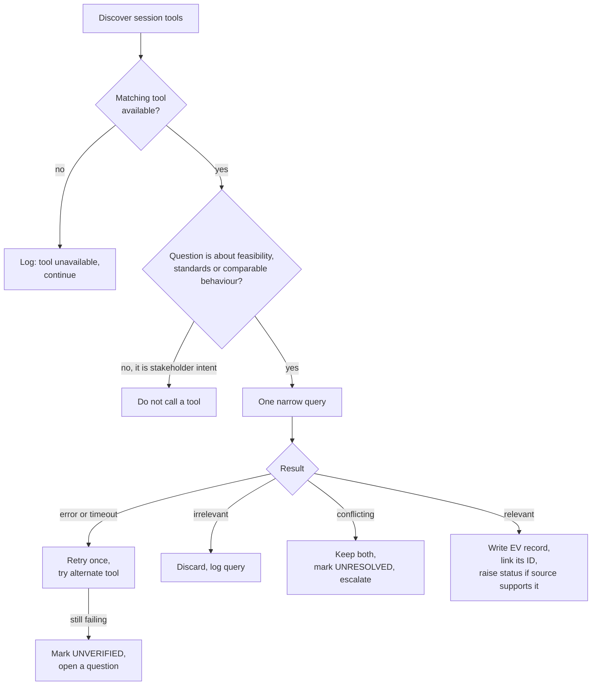
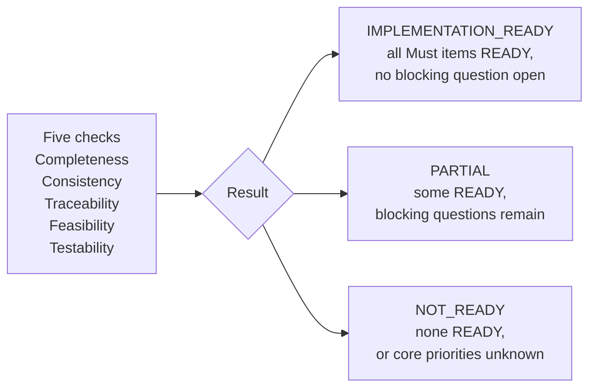
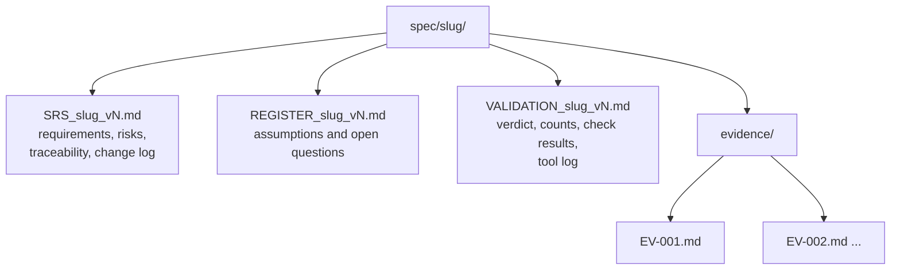

# SpecGate + MCP Fetch

SpecGate is a Claude Code skill (`specskill.md`) that turns a rough problem statement into a reviewable requirements specification. Nothing becomes a requirement until it passes the gate. The skill uses an MCP `fetch` server to gather citable evidence instead of relying on recall.

The skill produces a specification only. It never writes code, design, architecture or estimates.

## System overview



## Workflow

Steps 3 to 9 repeat after each clarification round.



## Status model

Each item carries exactly one status. Only a stakeholder answer can make an item CONFIRMED.



Readiness is separate from status:



## Who establishes what



## Tool use (MCP)



## Validation and verdict



## Output layout



Each clarification round writes a new version (`v1`, `v2`, ...). Earlier versions are kept.

## Element IDs

| Prefix | Element |
|---|---|
| ACT | Actor |
| FR | Functional requirement |
| NFR | Non-functional requirement |
| CON | Constraint |
| ASM | Assumption |
| DEP | Dependency |
| RSK | Risk |
| AC | Acceptance criterion |
| OQ | Open question |
| EV | Evidence |
| GLO | Glossary term |

IDs are assigned once and never reused.

## Setup

Register the MCP fetch server in Claude Code:

```
claude mcp add fetch -- uvx mcp-server-fetch
claude mcp list
```

`claude mcp list` should show `fetch` as connected. The first start can time out while `uvx` downloads the package. Run `/mcp` to reconnect.

## Use

```
/specgate <problem statement text or file path>
```

The skill runs only when you invoke it. Answer the questions it asks, and it writes the next version of the three files.

## Specifications produced so far

| Slug | Verdict |
|---|---|
| `web-fetch-mcp` | PARTIAL |
| `multitenant-doc-editor` | NOT_READY |
| `sovereign-agent-harness` | NOT_READY |

## Files

| Path | Purpose |
|---|---|
| `specskill.md` | The SpecGate skill definition |
| `spec/<slug>/` | Output for one problem statement |
