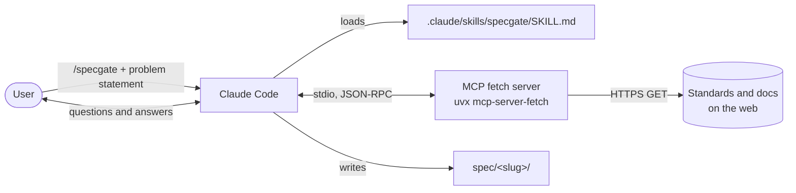
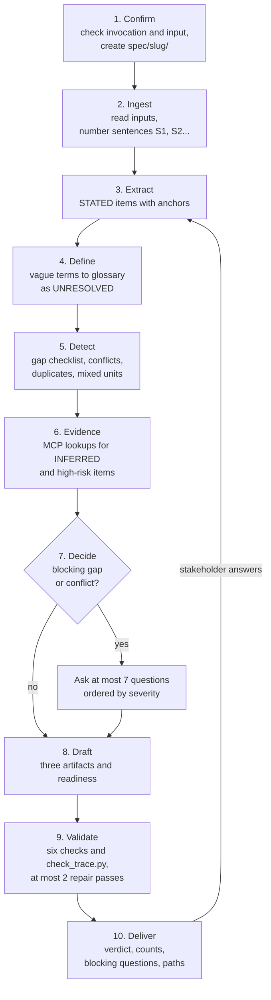
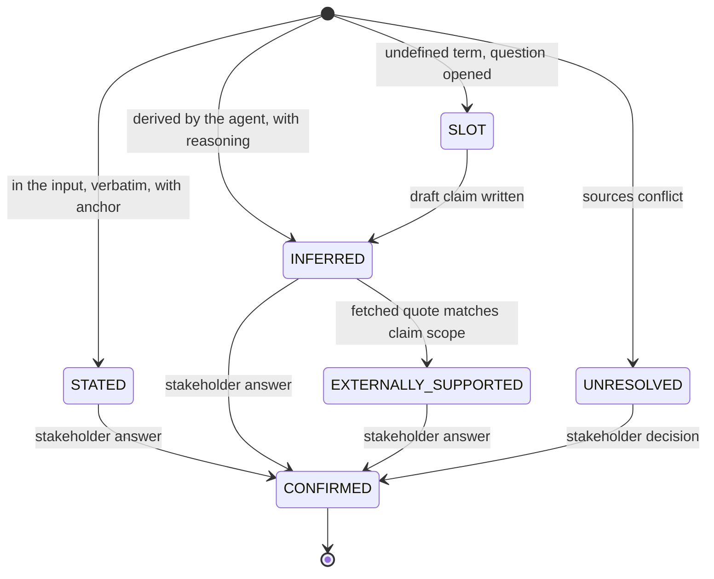
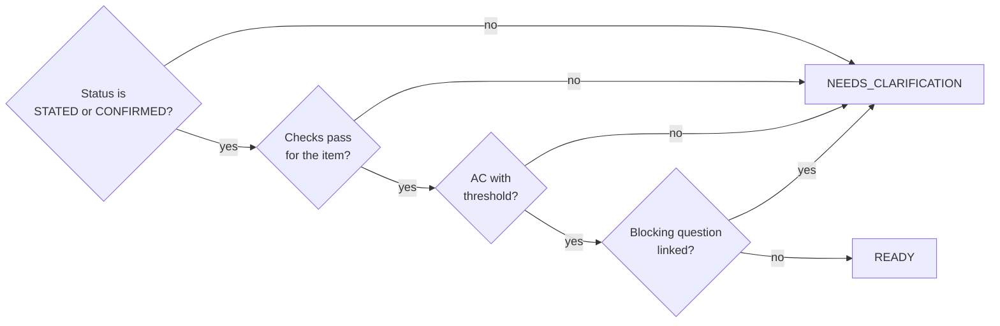
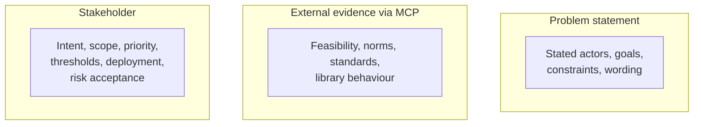
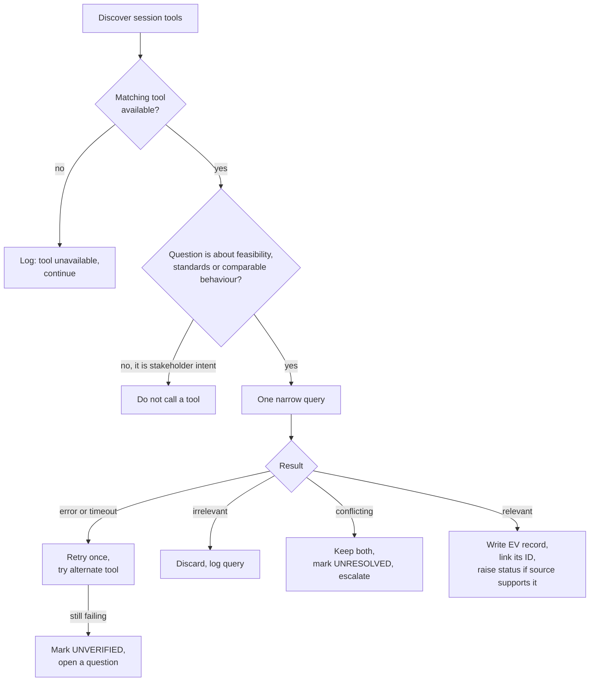
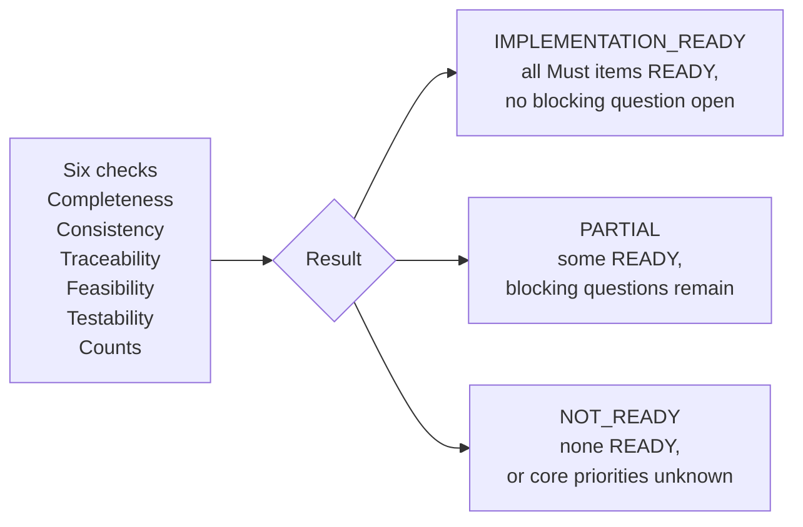
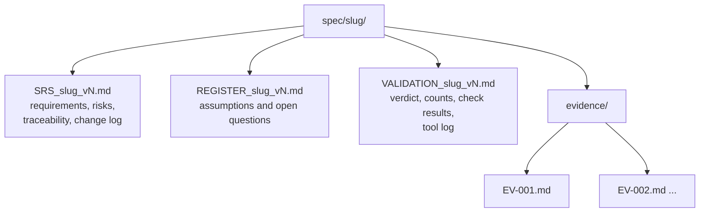

# SpecGate + MCP Fetch

SpecGate is a Claude Code skill (`.claude/skills/specgate/SKILL.md`) that turns a rough problem statement into a reviewable requirements specification. Nothing becomes a requirement until it passes the gate. The skill uses an MCP `fetch` server to gather citable evidence instead of relying on recall.

The skill produces a specification only. It never writes code, design, architecture or estimates.

## System overview



## Workflow

Steps 3 to 9 repeat after each clarification round.



## Status model

Each item carries exactly one status. Only a stakeholder answer can make an item CONFIRMED.



Readiness is separate from status:



## Who establishes what



## Tool use (MCP)



## Validation and verdict



## Output layout



Each clarification round writes a new version (`v1`, `v2`, ...). Earlier versions are kept.

## Element IDs

| Prefix | Element |
|---|---|
| ACT | Actor |
| FR | Functional requirement |
| NFR | Non-functional requirement |
| CON | Constraint |
| ASM | Assumption |
| DEP | Dependency |
| RSK | Risk |
| AC | Acceptance criterion |
| OQ | Open question |
| EV | Evidence |
| GLO | Glossary term |

IDs are assigned once and never reused.

## Setup

Register the MCP fetch server in Claude Code:

```
claude mcp add fetch -- uvx mcp-server-fetch
claude mcp list
```

`claude mcp list` should show `fetch` as connected. The first start can time out while `uvx` downloads the package. Run `/mcp` to reconnect.

## Skill location

Claude Code registers `/specgate` only from one of these paths:

* `.claude/skills/specgate/SKILL.md` (used here)
* `.claude/commands/specgate.md`

A file named `specskill.md` in the project root does not create the command. The command name comes from the `name: specgate` line in the skill's frontmatter and the folder name. Restart Claude Code after adding the file so it picks up the skill.

## Use

```
/specgate <problem statement text or file path>
```

The skill runs only when you invoke it. Answer the questions it asks, and it writes the next version of the three files.

## Tests

The test suite lives with the skill in `.claude/skills/specgate/tests/`. `TESTS.md` lists six cases (vague input, clarification round, numeric input, well-specified input, adversarial input, tool reliability) with the outcome each SpecGate rule requires. Run each case with `/specgate`, then audit the output:

```
python .claude/skills/specgate/scripts/check_trace.py spec/<slug> vN
```

## Files

| Path | Purpose |
|---|---|
| `.claude/skills/specgate/SKILL.md` | The SpecGate skill. This is the file Claude Code loads |
| `.claude/skills/specgate/scripts/mcp_fetch.py` | Calls the Fetch MCP server over stdio and saves the raw exchange. Used when the session has no `mcp__fetch__fetch` tool |
| `.claude/skills/specgate/scripts/check_trace.py` | Audits a run: counts by status and readiness, OQs by severity, duplicate IDs, two-way OQ links |
| `.claude/skills/specgate/tests/` | Test cases and expected outcomes |
| `.mcp.json` | Registers the Fetch MCP server (`uvx mcp-server-fetch`) for this project |
| `spec/<slug>/` | Output for one problem statement (created by a run) |
