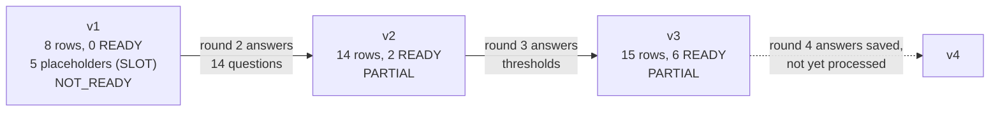

# Final report: Sovereign Agentic Harness specification

Date: 2026-10-18. Latest completed round: v3. Verdict: PARTIAL.

## 1. Result

SpecGate turned one vague sentence into a requirements specification over three rounds. The specification is not implementation-ready. Both Must requirements are READY, but one BLOCKING question is open: whether the Digital Personal Data Protection Act 2023 applies. It needs a legal expert, and no tool can settle it.

| | v1 | v2 | v3 |
|---|---|---|---|
| Verdict | NOT_READY | PARTIAL | PARTIAL |
| Requirement rows (FR, NFR, CON) | 8 | 14 | 15 |
| READY rows | 0 | 2 | 6 |
| Acceptance criteria | 0 | 2 | 6 |
| Open questions, answered / total | 0 / 15 | 14 / 20 | 16 / 20 |
| Open BLOCKING questions | 6 | 1 | 1 |
| Evidence records | 2 | 6 | 6 |

All counts come from `scripts/check_trace.py` (exit 0 on all three versions) and were cross-checked with Grep.

## 2. Input

> Let’s make India’s first sovereign local-first, enterprise-grade, model-agnostic, self-hosted, privacy-preserving, fully autonomous agentic harness, and let's really push it.

The sentence has nine adjectives and no requirement. Five were undefined vague terms. "India’s first" is a slogan and "really push it" has no testable content, so both were excluded from the requirements and the stakeholder confirmed the exclusion.

## 3. How the specification grew



- **v1:** every adjective became a question. FR-002 was raised from INFERRED to EXTERNALLY_SUPPORTED by one vendor document.
- **v2:** the stakeholder answered 14 questions. FR-001 and FR-003 became CONFIRMED and READY with thresholds (95 of 100 runs; install in 60 minutes or less). The answers also created the approval gate, kill switch, audit log, single sign-on and role-based access rows.
- **v3:** the stakeholder gave thresholds for approval, kill switch, audit log and the data boundary. Those four rows became READY. NFR-002 was split, because the boundary threshold tests only one of its two clauses.

## 4. Final requirement state (v3)

| ID | Requirement | Status | Priority | Readiness |
|---|---|---|---|---|
| FR-001 | Run AI agents that use tools to complete software engineering tasks | CONFIRMED | Must | READY |
| FR-002 | Run agents against more than one local or customer-hosted model through one interface | EXTERNALLY_SUPPORTED | Should | NEEDS_CLARIFICATION |
| FR-003 | Installable on, and run on, customer on-premises servers or customer-controlled cloud | CONFIRMED | Must | READY |
| FR-004 | Store task data locally, with optional sync to a customer server | CONFIRMED | Should | NEEDS_CLARIFICATION |
| FR-005 | Require human approval before an irreversible or externally visible action | CONFIRMED | Should | READY |
| FR-006 | Run with or without internet access at runtime | CONFIRMED | Should | NEEDS_CLARIFICATION |
| FR-007 | Provide a kill switch | CONFIRMED | Should | READY |
| FR-008 | Record an audit log of every agent action | CONFIRMED | Should | READY |
| FR-009 | Authenticate users through single sign-on | CONFIRMED | Should | NEEDS_CLARIFICATION |
| FR-010 | Restrict actions by user role | CONFIRMED | Should | NEEDS_CLARIFICATION |
| NFR-001 | Availability target | SLOT | Should | NEEDS_CLARIFICATION |
| NFR-002 | No data leaves the customer boundary unless an operator configures it | CONFIRMED | Should | READY |
| NFR-003 | Task data and source code protected from parties outside the boundary | CONFIRMED | Should | NEEDS_CLARIFICATION |
| CON-001 | Data stays in India | CONFIRMED | Should | NEEDS_CLARIFICATION |
| CON-002 | Meet the duties of the Digital Personal Data Protection Act 2023, where it applies | INFERRED | Should | NEEDS_CLARIFICATION |

Acceptance criteria written: AC-001 (FR-001), AC-002 (FR-003), AC-003 (FR-005), AC-004 (FR-007), AC-005 (FR-008), AC-006 (NFR-002). Each has a method and a stakeholder threshold.

## 5. Evidence

| EV | Source | Result | Effect |
|---|---|---|---|
| EV-001 | Web search for Ollama OpenAI-compatibility documentation | search | Located the official page |
| EV-002 | docs.ollama.com/api/openai-compatibility (vendor documentation) | success | FR-002 INFERRED to EXTERNALLY_SUPPORTED, feasibility FEASIBLE. Two models, `gpt-oss:20b` and `qwen3:8b`, on one local endpoint. Cloud examples excluded. One comparable only |
| EV-003 | Web search for the Act | search | Located official and secondary pages |
| EV-004 | India Code section page (official) | error: robots.txt 403 | No change. No retry, no workaround |
| EV-005 | MeitY PDF (official) | error: robots.txt 403 | No change |
| EV-006 | PRS India bill-track page | success, secondary | No change. Secondary sources cannot raise a status |

One status was raised by evidence. The legal source could not be read by the Fetch server, so CON-002 stays INFERRED and legal facts stay unverified.

## 6. Open items

| Question | Severity | Owner | Why it matters |
|---|---|---|---|
| OQ-019 Does the Act apply, and which duties? | BLOCKING | Legal expert | Blocks IMPLEMENTATION_READY. The stakeholder asked for escalation |
| OQ-016 Thresholds for FR-002, FR-004, FR-006, FR-009, FR-010, NFR-003, CON-001 | MEDIUM | Stakeholder | Seven rows cannot be READY without them |
| OQ-017 Availability target | MEDIUM | Stakeholder | NFR-001 is still a placeholder |
| OQ-013 Scale and speed targets | MEDIUM | Stakeholder | No performance row exists |

## 7. Round 4 answers, saved but not processed

`stakeholder_answers_v4.md` holds answers for OQ-017 (99.5 percent per month, recovery 4 hours, data loss limit 1 hour), OQ-013 (100 users, 20 concurrent agents per server, 500 tasks per day, 95th percentile task start under 5 seconds) and four of the OQ-016 thresholds. It was not run through `/specgate`, so v4 does not exist. Two answers do not fit the current rows:
- The threshold labelled NFR-003 is a performance threshold, but NFR-003 is the privacy clause. It needs a new performance row.
- The FR-004 threshold mixes offline task completion with sync resuming, and the offline part overlaps FR-006.

## 8. Limitations

- **Simulated respondent:** every answer comes from a simulated stakeholder. No row is a real commitment.
- **Thin evidence:** one status was raised, from one vendor page. Nothing was verified against the law.
- **No legal opinion:** CON-001 and CON-002 are unverified. A secondary source suggests the Act allows transfers outside India, so "data stays in India" may be a stakeholder rule and not a statutory one. A legal expert must confirm.
- **Test suite not run:** `tests/TESTS.md` defines six cases. I did not execute them in this session, so the skill itself is not scored here.
- **Skill copies:** I did not re-compare `~/.claude/skills/specgate/` with the project copy after the last sync.
- **Repeated runs:** v1 was regenerated several times in this session after the folder was deleted. The final v1 is the last one written.

## 9. Files

```
spec/sovereign-agent-harness/
├── SRS_sovereign-agent-harness_v1.md, _v2.md, _v3.md
├── REGISTER_sovereign-agent-harness_v1.md, _v2.md, _v3.md
├── VALIDATION_sovereign-agent-harness_v1.md, _v2.md, _v3.md
├── stakeholder_answers_v2.md, _v3.md, _v4.md
├── FINAL_REPORT.md
└── evidence/EV-001.md to EV-006.md
```

To reproduce the audit:

```
python .claude/skills/specgate/scripts/check_trace.py spec/sovereign-agent-harness v3
```

To process the saved round-4 answers:

```
/specgate spec/sovereign-agent-harness/stakeholder_answers_v4.md
```
